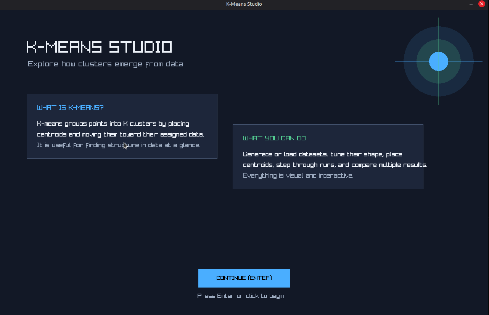
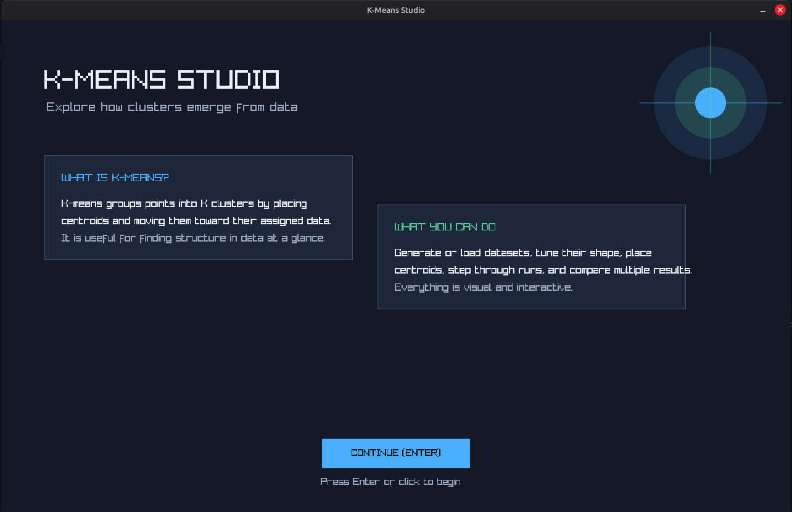
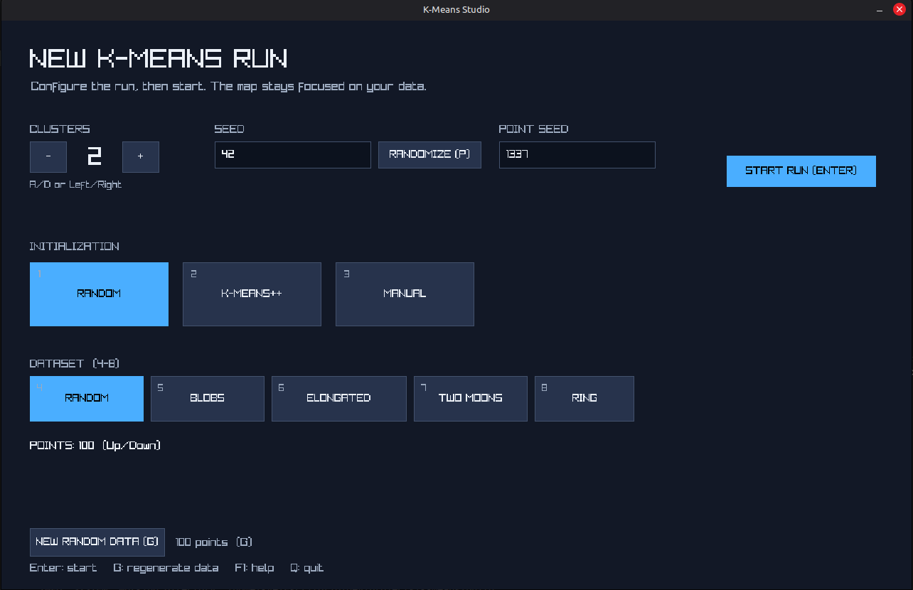
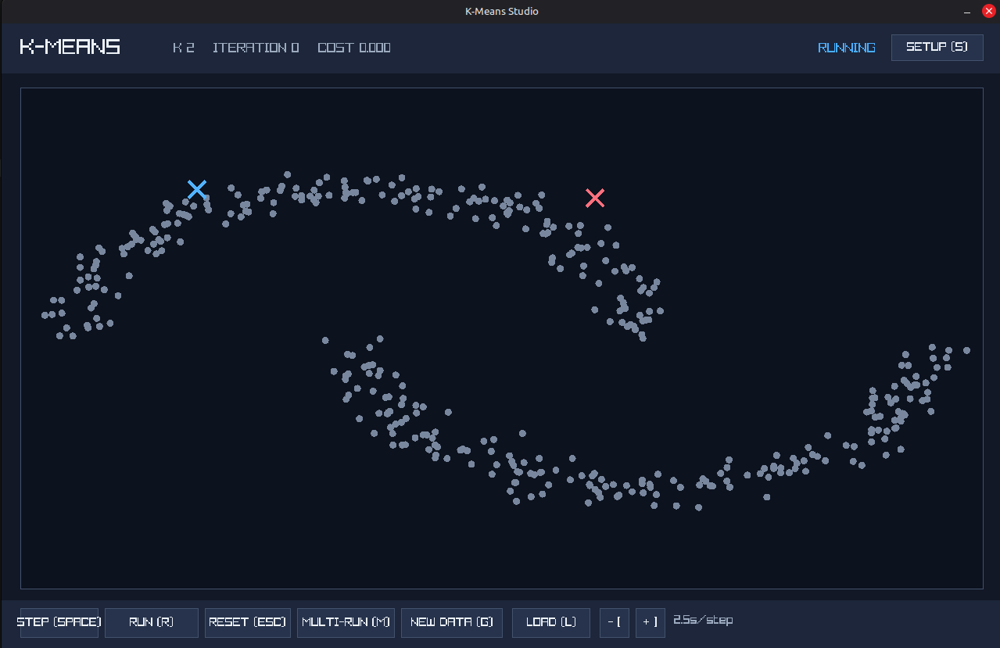
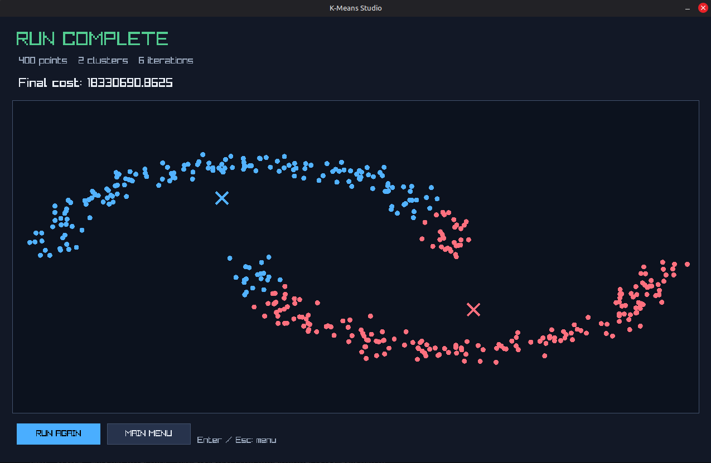
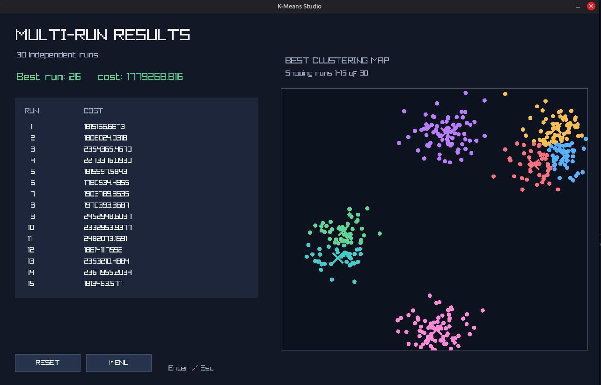

# K-Means Studio


An interactive, real-time C++17 application for exploring K-Means clustering.
Generate or load two-dimensional datasets, configure centroid initialization,
and watch assignments, centroid movement, cost, and convergence develop on an
interactive map.



---

## Screenshots


<table>
  <tr>
    <td align="center" width="50%">
      
      <br><sub><b>Welcome Screen</b><br>A short introduction to K-Means Studio</sub>
    </td>
    <td align="center" width="50%">
      
      <br><sub><b>Dataset Setup</b><br>Configure K, seeds, and dataset parameters</sub>
    </td>
  </tr>
  <tr>
    <td align="center" width="50%">
      
      <br><sub><b>Interactive Simulation</b><br>Watch clusters and centroids change in real time</sub>
    </td>
    <td align="center" width="50%">
      
      <br><sub><b>Convergence Summary</b><br>Review the final cost, iterations, and map</sub>
    </td>
  </tr>
  <tr>
    <td align="center" colspan="2">
      
      <br><sub><b>Multi-Run Comparison</b><br>Compare independent initializations and view the best result</sub>
    </td>
  </tr>
</table>

---

## Features

- **Interactive K-Means:** Assign points to their nearest centroid, recalculate
  means, and repeat until convergence.
- **Three initialization modes:** Randomized centroid placement, K-Means++,
  and manual centroid placement.
- **Dataset generation:** Create random, blob, elongated-cluster, Two Moons,
  and ring datasets.
- **Dataset configuration:** Adjust point count, independent point and centroid
  seeds, blob count, standard deviations, ring/moon radius, and ring thickness.
- **Custom dataset loading:** Load two-dimensional point coordinates from a
  space-delimited file.
- **Step-by-step or automatic execution:** Inspect each iteration or let the
  simulation run automatically with adjustable speed.
- **Convergence summary:** View final metrics and the resulting clustering map.
- **Multi-run comparison:** Run multiple independent initializations, scroll
  through their costs, and inspect the best final map.
- **Interactive map:** Add points manually, pan, zoom, and reset the view.
- **Keyboard-first controls:** Every major action is available through a
  keyboard shortcut shown in the interface.

---

## Build and Run

### Requirements

- C++17-compatible compiler (`gcc`, `clang`, or `MSVC`)
- CMake 3.15 or newer
- Desktop graphics environment with OpenGL support

> **Note:** CMake fetches Raylib during the initial configuration if it is not
> already available. An active internet connection may be required the first
> time the project is configured.

### Build Steps

```sh
# Clone the repository
git clone https://github.com/KyeRogers/k-means-visualizer.git
cd k-means-visualizer

# Configure and build
cmake -S . -B build
cmake --build build

# Run the executable
./build/k-means
```

---

## Controls

| Input | Action |
| :--- | :--- |
| **Enter** | Continue from the welcome screen or start a configured run |
| **Left Click** | Add a point to the map or activate a control |
| **Backspace** | Remove the last manually placed centroid |
| **Space** | Step one K-Means iteration |
| **R** | Start or stop automatic execution |
| **Esc** | Reset the current run or leave result screens |
| **`[` / `]`** | Decrease or increase automatic run speed |
| **M** | Open multi-run setup |
| **S** | Open the setup screen |
| **F1** or **H** | Toggle the help panel |
| **F2** | Reset map zoom and pan |
| **L** | Open point-file loading |
| **G** | Generate a fresh dataset using the current dataset settings |
| **P** | Randomize the centroid seed |
| **4–8** | Select Random, Blobs, Elongated, Two Moons, or Ring datasets |
| **Up / Down** | Change generated point count or scroll multi-run results |
| **`,` / `.`** | Decrease or increase blob count |
| **J / K** | Decrease or increase X standard deviation |
| **U / I** | Decrease or increase Y standard deviation for elongated clusters |
| **N / B** | Decrease or increase ring/moon radius |
| **Middle Drag / Wheel** | Pan or zoom the map |
| **Q** | Quit |

The setup screen displays the controls relevant to the selected dataset. For
example, blob count is shown only for blob-based datasets, while radius is
shown for Ring and Two Moons datasets. For Ring datasets, standard deviation
controls the maximum ring thickness.

---

## Loading Point Files

Point files contain one `x y` coordinate pair per line, separated by spaces:

```text
120 240
150 210
620 510
590 540
```

Coordinates should normally fall within the visualizer's `0` to `1000` world
range. Choose **LOAD (L)**, type the file path, and press Enter.

---

## How K-Means Works

For a selected value of `K`, the algorithm:

1. Initializes `K` centroids.
2. Assigns each point to its nearest centroid.
3. Moves each centroid to the mean of its assigned points.
4. Repeats until assignments and centroids converge.

The visualizer reports the current iteration and clustering cost, making the
optimization process visible. Different initialization seeds can reach
different local minima, which is why the multi-run view is useful.

---

## Architecture

```text
┌───────────────────────────────────────────────────────────────┐
│                           Renderer                            │
│        Raylib window, screens, controls, map visualization    │
└───────────────────────────────┬───────────────────────────────┘
                                │
                                ▼
┌───────────────────────────────────────────────────────────────┐
│                           Simulator                           │
│       K-Means lifecycle, iteration loop, seeds, file I/O     │
└───────────────────────────────┬───────────────────────────────┘
                                │
                                ▼
┌───────────────────────────────────────────────────────────────┐
│                        DatasetGenerator                       │
│       Configurable two-dimensional dataset generation        │
└───────────────────────────────────────────────────────────────┘
```

- **`Renderer`** manages the welcome screen, setup menu, simulation dashboard,
  convergence summary, multi-run results, input, and map drawing.
- **`Simulator`** owns points, centroids, K-Means state, iteration timing,
  convergence, and multi-run execution.
- **`DatasetGenerator`** creates configured point distributions using separate
  dataset and centroid randomness.

---

## License

Distributed under the MIT License. See `LICENSE` for details.
